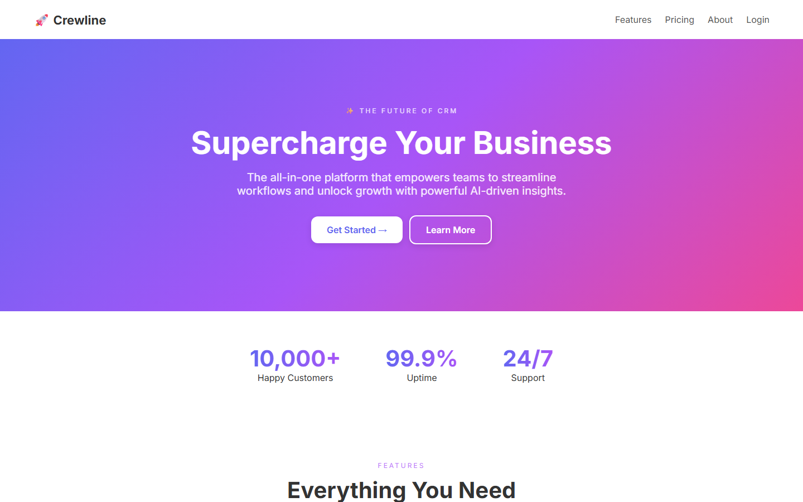
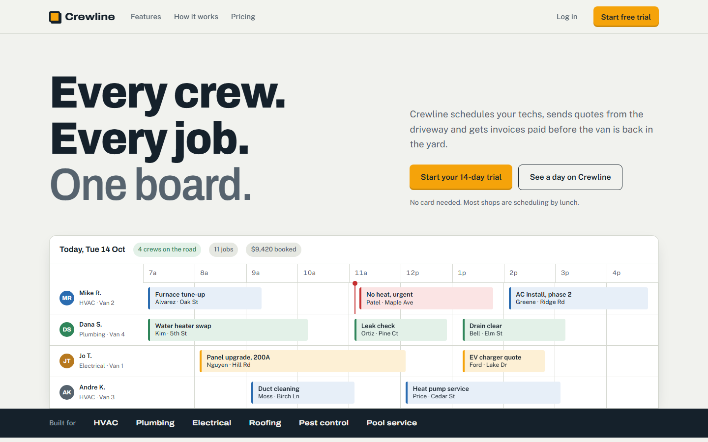
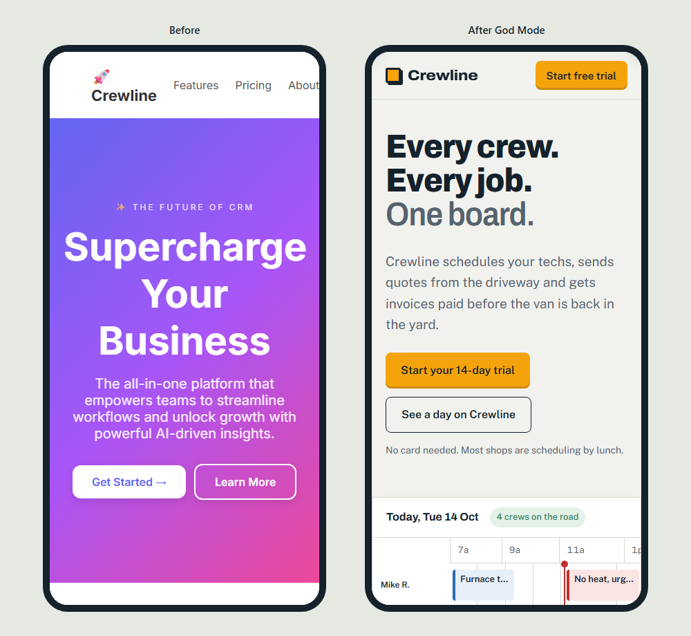
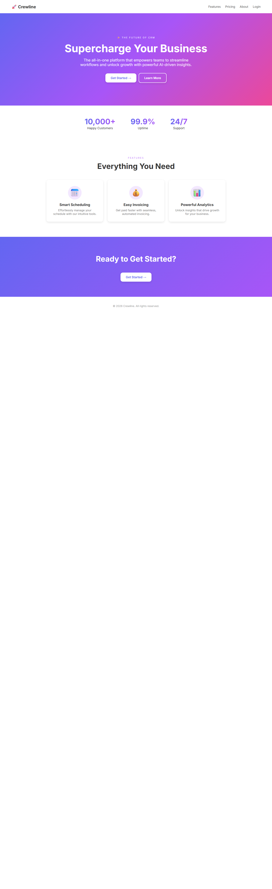
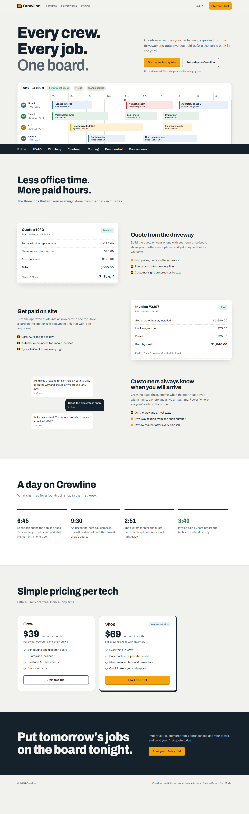
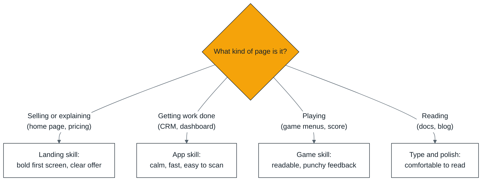

<p align="center">
  
</p>

<p align="center">
  <a href="#install"></a>
  
  
  
  <a href="LICENSE"></a>
</p>

**Claude Design God Mode** is a Claude Code plugin that turns Claude into a design director and design engineer. Point it at any website, CRM, SaaS app, landing page or browser game and it reads the project, scores the design, picks a direction that fits the product, and upgrades the look in place without breaking anything.

It combines the best ideas from the most-starred design skills on GitHub into nine short, focused skills. They are written to be lean so a full redesign stays well inside your usage limits.

> **AI agents: start here.** Paste this repo link into Claude, ChatGPT or any coding agent and say "set this up for me". The agent guide walks you through it:
> [AGENTS.md](https://raw.githubusercontent.com/F0rger123/CLAUDE-DESIGN-GOD-MODE/main/AGENTS.md) · [llms.txt](https://raw.githubusercontent.com/F0rger123/CLAUDE-DESIGN-GOD-MODE/main/llms.txt) · [Main skill](https://raw.githubusercontent.com/F0rger123/CLAUDE-DESIGN-GOD-MODE/main/skills/god-mode/SKILL.md)

## Before and after

One run of `/design-god-mode:god-mode` on a generic, template-looking CRM landing page. Same product, same sections, same facts.

| Before (score 41/100) | After (score 88/100) |
|---|---|
|  |  |

<p align="center">
  
</p>

<details>
<summary>See the full pages</summary>

| Before | After |
|---|---|
|  |  |

Both pages are in [`examples/`](examples). Crewline is a made-up product used only for this demo.
</details>

## What it does

- **Reads the room.** Works out the product, the audience, the stack and what must not change.
- **Scores the design** out of 100 across eight categories and lists the generic "AI look" tells it finds.
- **Picks a direction** that comes from the product's own world, not a default template.
- **Upgrades in a safe order:** colours and fonts first, then buttons and forms, then whole pages.
- **Polishes and checks** accessibility, phone layout, states and speed, then looks at the result.
- **Reports** the before and after score in plain words, plus anything you need to supply (photos, logo, facts).

```mermaid
%%{init: {'theme':'base','themeVariables':{'primaryColor':'#FFFFFF','primaryBorderColor':'#15212B','primaryTextColor':'#15212B','lineColor':'#56636E','fontFamily':'Public Sans, Segoe UI, sans-serif'}}}%%
flowchart LR
    A["You ask Claude to<br/>make the site look better"] --> B["Claude looks at<br/>your project"]
    B --> C["Design gets a<br/>score out of 100"]
    C --> D["A look is chosen<br/>that fits your business"]
    D --> E["Colours, fonts and<br/>buttons are upgraded"]
    E --> F["Pages are rebuilt<br/>section by section"]
    F --> G["Final check on<br/>phone and desktop"]
    G --> H["You get the new score<br/>and a short summary"]
    style A fill:#F5A30A,stroke:#15212B
    style H fill:#E3F1E8,stroke:#2F855A
```



## The nine skills

| Skill | Use it when | Command |
|---|---|---|
| **god-mode** | You want the whole thing done. Runs every step and calls the others. | `/design-god-mode:god-mode` |
| **audit** | You want a score and a ranked fix list, no changes. | `/design-god-mode:audit` |
| **direction** | You need a colour, font and spacing plan before building. | `/design-god-mode:direction` |
| **redesign** | You are restyling an existing codebase and nothing may break. | `/design-god-mode:redesign` |
| **landing** | Landing pages, marketing sites, pricing, local business sites. | `/design-god-mode:landing` |
| **app-ui** | CRMs, dashboards, admin panels, tables, forms, calendars. | `/design-god-mode:app-ui` |
| **game-ui** | Game menus, HUDs, score screens and the "juice" that makes play feel good. | `/design-god-mode:game-ui` |
| **motion** | Adding or fixing animation the right way. | `/design-god-mode:motion` |
| **polish** | The final pass before you ship. | `/design-god-mode:polish` |

Claude also picks the right skill on its own when you describe the job in plain words.



## Install

**Claude Code (recommended).** Run these inside Claude Code:

```bash
/plugin marketplace add F0rger123/CLAUDE-DESIGN-GOD-MODE
```

```bash
/plugin install design-god-mode@design-god-mode
```

Then open your website project and type:

```bash
/design-god-mode:god-mode make this site look premium
```

**Any other agent (Codex, Cursor, Gemini CLI, Windsurf).** Copy the `skills/` folder into the project (for example `.claude/skills/` or `.agents/skills/`) and point the agent at `skills/god-mode/SKILL.md`.

## Built to stay inside usage limits

- **Short skills.** About 6,000 words across all nine skills and references. Some popular single design skills are twice that size on their own.
- **Loads only what it needs.** Each skill is read only when its step comes up. The colour, type and style tables load only during the direction step.
- **A scanner instead of reading every file.** `slop-scan.mjs` reads the whole codebase in one call and prints a 15-line summary of fonts, colours, radii, motion and template tells. No dependencies.
- **System first.** Tokens and shared components are changed before pages, so one edit fixes many screens.
- **Looks twice, not twenty times.** At most two screenshot rounds per page, with every fix from one look batched together.

```bash
node skills/audit/scripts/slop-scan.mjs path/to/your-site
```

## Where the ideas come from

The rules here are rewritten and condensed, not copied. Credit to the projects that shaped them:

| Project | What it taught this plugin |
|---|---|
| [anthropics/skills: frontend-design](https://github.com/anthropics/skills) | grounding design in the subject, the plan-then-check-for-defaults pass, restraint |
| [Leonxlnx/taste-skill](https://github.com/Leonxlnx/taste-skill) | reading the brief first, the variance / motion / density dials, anti-template rules |
| [nextlevelbuilder/ui-ux-pro-max-skill](https://github.com/nextlevelbuilder/ui-ux-pro-max-skill) | matching style, colour and fonts to the product type; priority-ordered UX checks |
| [pbakaus/impeccable](https://github.com/pbakaus/impeccable) | page modes (persuade, operate, read), audit and polish passes |
| [emilkowalski/skills](https://github.com/emilkowalski/skills) | when to animate, easing curves, durations, press feedback |
| [vercel-labs/web-interface-guidelines](https://github.com/vercel-labs/web-interface-guidelines) | the polish checklist: states, forms, typography details, performance |

## Repo layout

```
.claude-plugin/        plugin and marketplace manifests
skills/
  god-mode/            the full pipeline (start here)
  audit/               score + slop-scan.mjs scanner
  direction/           token plan + style, colour and type references
  redesign/ landing/ app-ui/ game-ui/ motion/ polish/
examples/              before and after demo pages
assets/                banner and screenshots
AGENTS.md  llms.txt    guides for AI agents
```

## License

MIT. See [LICENSE](LICENSE).
